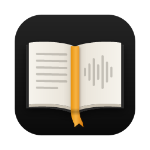
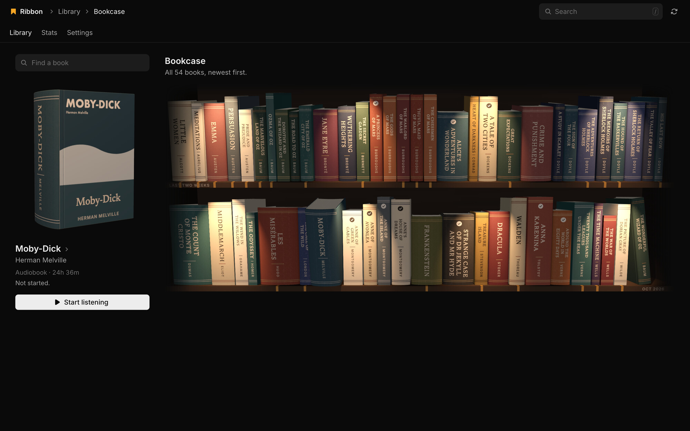
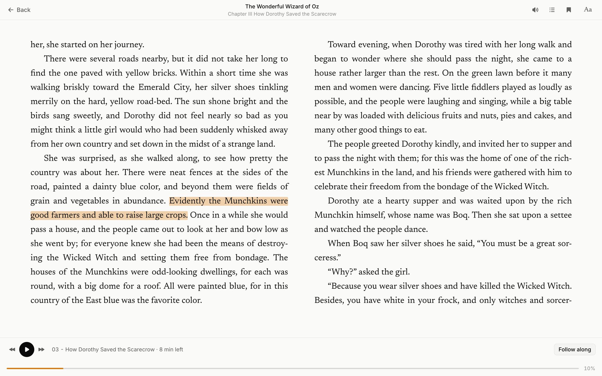
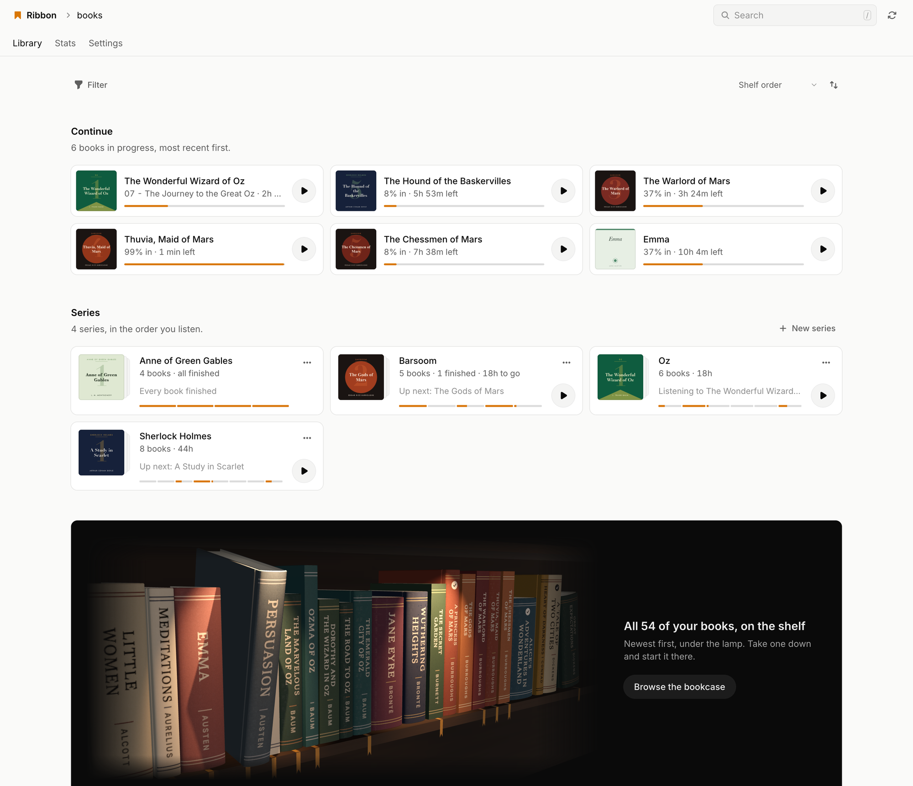
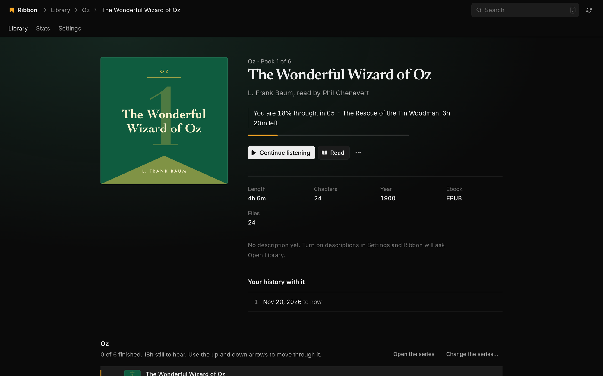
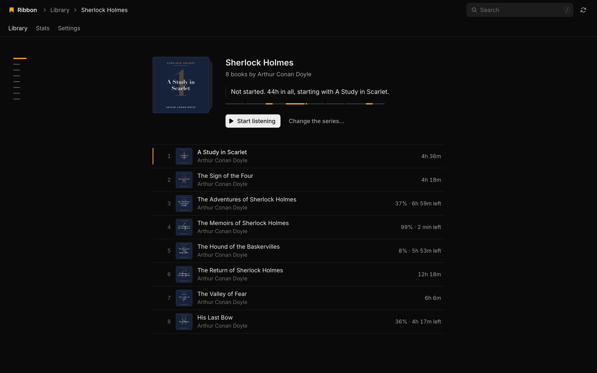
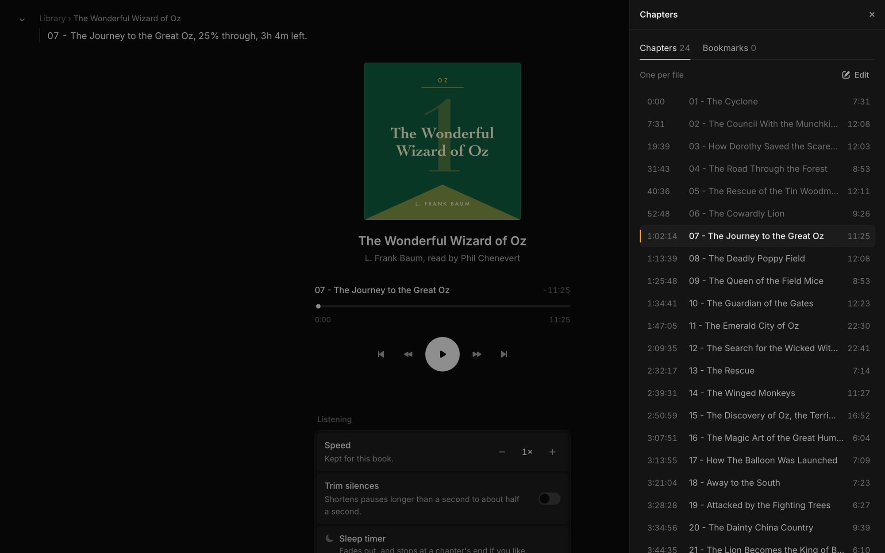
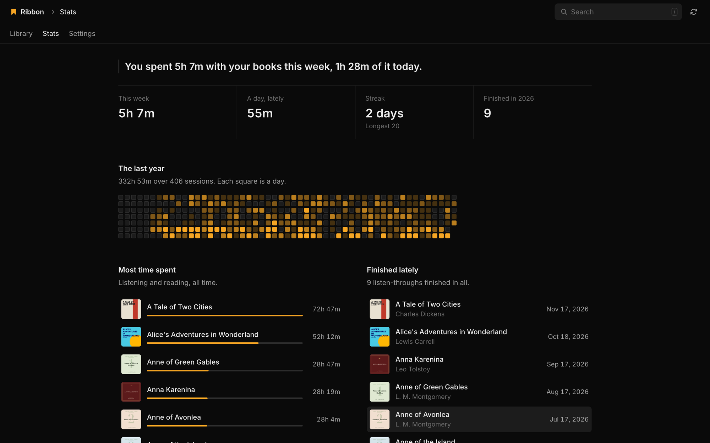

<div align="center">



# Ribbon

**A home for your books, read or heard.**

A reader and a player for the EPUBs and audiobooks you own, as files, with one
place in every book and read-along between the two.<br>
No DRM, no store, and nothing in anyone else's cloud.

[](https://github.com/KhalidAdan/ribbon/releases)
[](https://github.com/KhalidAdan/ribbon/actions/workflows/checks.yml)
[](LICENSE)


[Install](#install) · [What it does](#what-it-does) · [Two ways to run it](#two-ways-to-run-it) · [Build it yourself](#build-it-yourself) · [Read more](#read-more)

<br>

<a href="docs/images/bookcase.jpg"></a>

</div>

## Why

Every audiobook app and every ebook reader feels the same, and none of them
treats the two editions of one book as one book. Ribbon does. Read on the
train, put the headphones on to walk home, read again in bed, and the book is
always where you left off, with the sentence being narrated marked on the page
when you want it.

Your books stay files in your own folders, or on a server of your own. Your
place in each is a small file beside the book, in
[a format anyone can read and write](docs/POSITION-FORMAT.md).
[docs/NORTHSTAR.md](docs/NORTHSTAR.md) says what Ribbon is and what it refuses
to be.

## What it does

### Reads along with the narrator

When you own a book both ways, Ribbon listens to the narration once, on your
own computer, and finds every sentence in the text. After that the page follows
the voice: the sentence being read is marked, and the page turns by itself.
Tap any sentence to hear the book from there.

<picture>
  <source media="(prefers-color-scheme: dark)" srcset="docs/images/read-along.png">
  
</picture>

- **A page worth reading.** EPUBs are set in pages or as one long scroll, with
  the size, spacing and width you choose, and a page that turns the moment you
  ask.
- **Heard on your machine.** The narration is transcribed by
  [whisper.cpp](https://github.com/ggerganov/whisper.cpp) on your graphics
  card. Nothing is sent anywhere.
- **Text on its own is a book too.** An EPUB with no audiobook is a book like
  any other, and so is an audiobook with no text.

### Keeps the whole library in one place

Point Ribbon at a folder and it finds the books in it: what you're in the
middle of, your series in the order you listen to them, and how far you are
through each. The books stay where they are.

<picture>
  <source media="(prefers-color-scheme: dark)" srcset="docs/images/library.png">
  
</picture>

| A book's page | A series |
| :---: | :---: |
|  |  |

- **M4B, MP3, Opus and FLAC**, and EPUBs without DRM. If it plays in ffmpeg
  without a key, it plays here.
- **Series you arrange**, with a book in as many of them as you like.
- **The bookcase**, at the top of this page: every book spine-out under a
  lamp. Take one down and start it.

### Plays the way a book should be played

The difference between "fine" and "I would never switch" is a dozen small
behaviours, and Ribbon tries to get each of them right.

| The player | A year of listening |
| :---: | :---: |
|  |  |

- **It opens where you were**, in every book, whether you were reading or
  listening.
- **Every book at the same volume.** Each is measured once, so a quiet
  recording and a loud one play alike.
- **Speed kept for each book**, pauses trimmed if you like, and MP3s that
  start at the exact moment asked for.
- **A sleep timer** that fades out, and can wait for the chapter's end.
- **Chapters** read from the files, named from the book's own contents, and
  yours to correct. **Bookmarks** with a clip of what was said, and
  **highlights** in the text.
- **Your own history**: what you read and when, a daily goal if you want one,
  and no one else counting.

### What it refuses to be

- **Not a DRM client.** Ribbon never opens an AAX file or a locked EPUB.
- **Not a store, and not a social network.** No catalogue, no recommendations,
  no friends.
- **Not someone else's service.** Your own computer, or your own server for
  your own people. No account with anyone, and no tracking.

## Two ways to run it

| | What you install | What you get |
| --- | --- | --- |
| **On one computer** | The desktop app | All of Ribbon, from your own folders: reading, listening and read-along. No account, and nothing else to run. |
| **Everywhere** | The desktop app and a server, then the Apple app if you want it | The iPhone, iPad and Apple TV, other people with places of their own, and your place in every book on every device. |

Start with the desktop app. A server is something you add when you want more
than one computer, and your books move to it with your place in each.

## Install

**The desktop app**, for Windows x64 and Macs with Apple Silicon: download it
from [Releases](https://github.com/KhalidAdan/ribbon/releases). Install
[ffmpeg](https://ffmpeg.org) as well (`brew install ffmpeg` on a Mac): Ribbon
reads chapters, measures loudness and makes bookmark clips with it, and it
isn't in the download.

The builds aren't signed yet. The first time you open Ribbon on a Mac, macOS
refuses it: open it from System Settings → Privacy & Security → Open Anyway.
Windows may warn that it doesn't know the publisher. From 0.30 on, Ribbon
updates itself: it downloads each new version in the background and installs
it when you restart or close it (Settings, Online, turns that off). To update
an older version, close Ribbon and install the new one over it; everything
carries over.

**The server** runs on a machine of your own, in Docker or with Node:
[packages/server/README.md](packages/server/README.md).

**The iPhone, iPad and Apple TV app** needs a server. For now you build it
with Xcode: [packages/apple/README.md](packages/apple/README.md).

## What's in this repository

```text
packages/
  core/         @ribbon/core: pure logic, no files or network, for the app and the server
  host-node/    @ribbon/host-node: file and process access on Node
  server/       @ribbon/server: the server
  desktop/      @ribbon/desktop: the desktop app
    src/          its web side: app/ (state and actions), reader/, player/, ui/, host/
    src-tauri/    its Rust side, and the crates the server builds (ebook/, frames/)
    test/         its tests
    tools/        the command line, fixtures and the end-to-end checks
  apple/        the iPhone, iPad and Apple TV app, in Swift
tools/          checks for the whole repository
docs/           how it all works, and why
```

It's one repository, with npm workspaces, because the server and the desktop
share their logic: a change to how a book is read, or to what the server sends,
is one change across every part it touches.

## Build it yourself

Node 24 or newer, Rust stable, and `ffmpeg` with `ffprobe` on the PATH.
Building the speech side (whisper.cpp, for read-along) also needs CMake. On
Windows it needs LLVM (for libclang, expected in `C:\Program Files\LLVM`) and
the Vulkan SDK with `VULKAN_SDK` set; on a Mac, Xcode, and whisper.cpp runs on
Metal ([docs/MAC.md](docs/MAC.md)). `npm run tauri` and `tauri:dev` set how
whisper.cpp is compiled on each system (`packages/desktop/tools/with-build-env.mjs`). Cargo
builds into `target/` at the repository's root, because whisper.cpp's shader
build is too deep for Windows paths under `packages/desktop/src-tauri/target/`.

```sh
npm install
npm run tauri:dev          # the desktop app
```

On first launch, add a folder of books. Ribbon scans it, writes its records to
`<folder>/.ribbon/`, and opens the library. An EPUB goes with its audiobook;
an EPUB with no audiobook is a book to read
([docs/READING.md](docs/READING.md), section 2). Add more folders from
Settings: the library is every folder together, and the books stay where they
are. Launch with a folder as the argument, or set `RIBBON_LIBRARY`, to add it
without the picker.

### In a browser

The same UI runs in a browser tab against a folder on this machine, served by
a Vite plugin. It is a development harness, not a server.

```sh
RIBBON_DEV_LIBRARY=path/to/books npm run dev     # defaults to ./books if present
```

Then open http://localhost:1420. In dev builds the app controller is exposed
as `window.__ribbon`.

### Tests

```sh
npm test                       # unit and fixture tests; ffmpeg generates fixtures once
RIBBON_BOOKS=books npm test    # also assert against a real library folder
npm run typecheck
npm run test:rust              # the Rust side
npm run ribbon -- scan books   # scan from the command line, no app
npm run ribbon -- chapters books "Horus Rising"
```

The server has its own: `npm test` and `npm run typecheck` in `packages/server/`. The
end-to-end checks run the built app: [packages/desktop/tools/e2e/README.md](packages/desktop/tools/e2e/README.md).

## Read more

| | |
| --- | --- |
| [docs/NORTHSTAR.md](docs/NORTHSTAR.md) | What Ribbon is and refuses to be |
| [docs/ARCHITECTURE.md](docs/ARCHITECTURE.md) | How it fits together, in diagrams, and where to start reading code |
| [docs/SERVER.md](docs/SERVER.md) | The server's design |
| [docs/READING.md](docs/READING.md) | The reader and read-along |
| [docs/POSITION-FORMAT.md](docs/POSITION-FORMAT.md) | The position log, a format anyone can read and write |
| [docs/DESIGN.md](docs/DESIGN.md) | The look |
| [docs/RELEASING.md](docs/RELEASING.md) | Cutting a release |
| [docs/MAC.md](docs/MAC.md) | Developing on a Mac |
| [docs/TEST-PLAN.md](docs/TEST-PLAN.md) | What "correct" means |
| [docs/PLAN.md](docs/PLAN.md) | How version one was built |

## About the pictures

The screenshots are the desktop app on a sample library of books long out of
copyright. Their covers were drawn for these pictures, and most of the
audiobooks behind them are silence with a made-up narrator's name. The one
real recording is *The Wonderful Wizard of Oz*, read by Phil Chenevert for
[LibriVox](https://librivox.org), with its text from
[Project Gutenberg](https://www.gutenberg.org): the pair the end-to-end checks
read along with.

## Licence

MIT. See [LICENSE](LICENSE).
