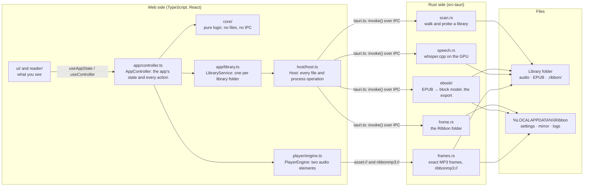
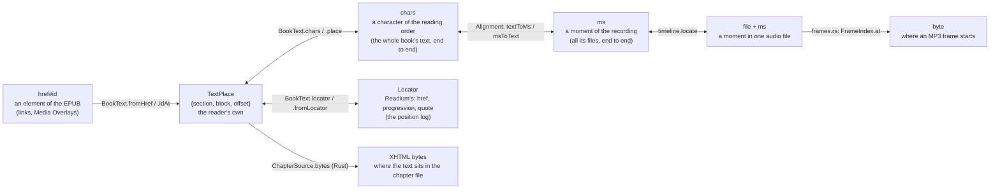
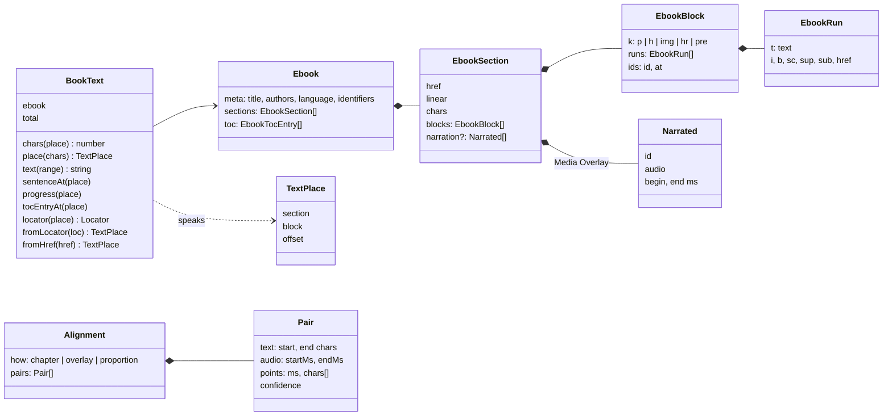
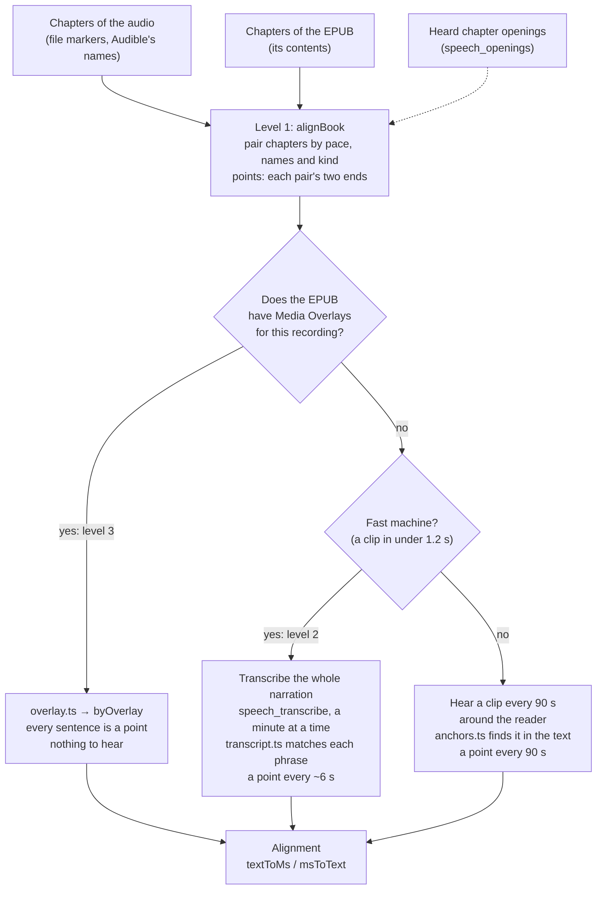
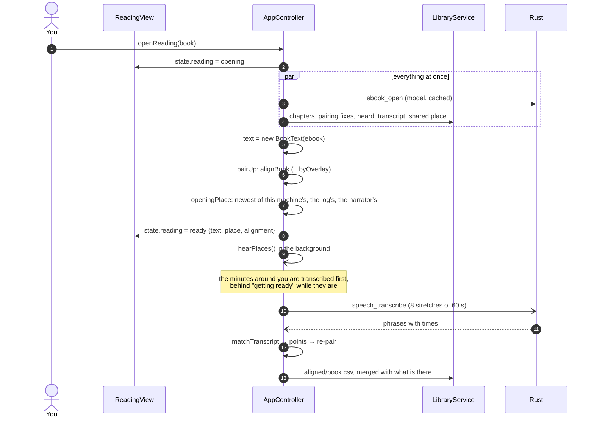
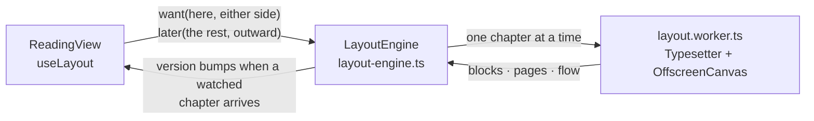
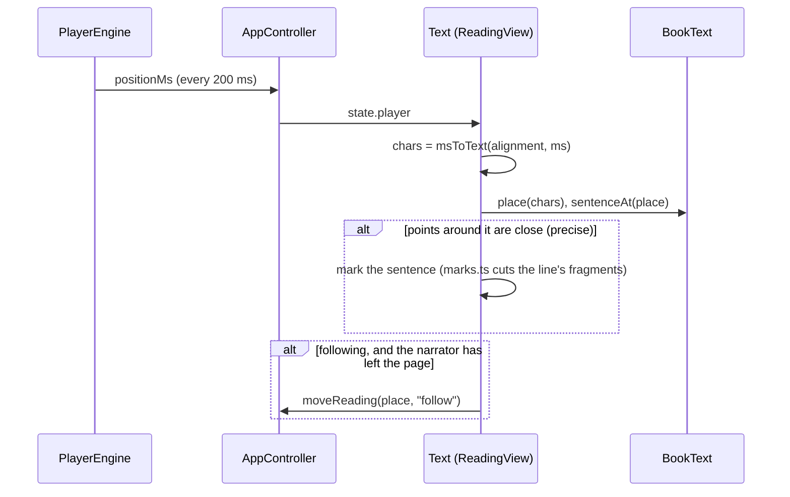
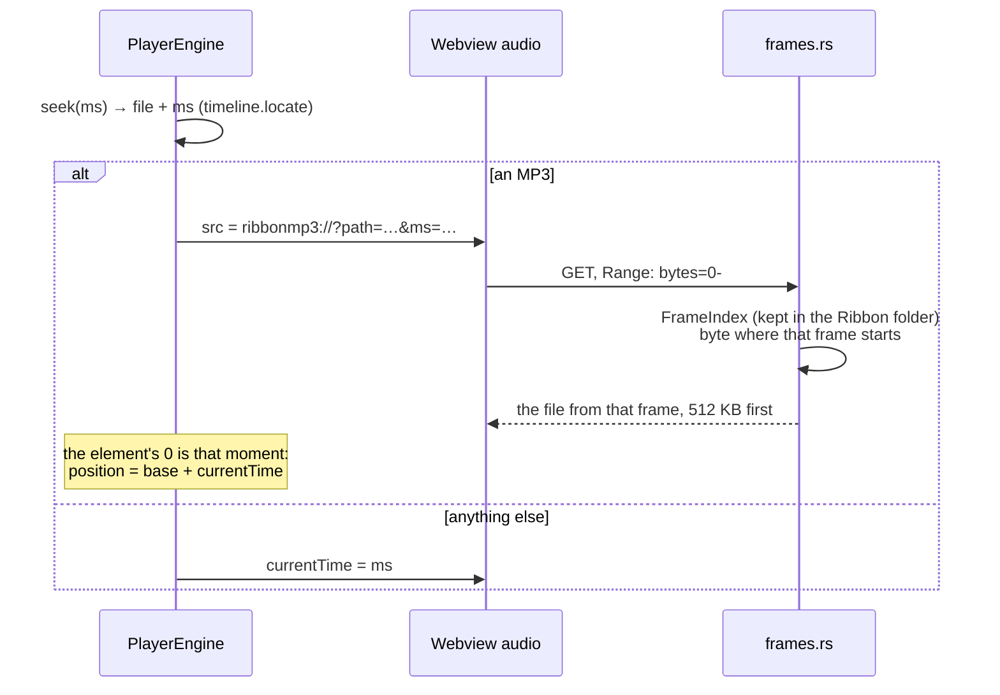
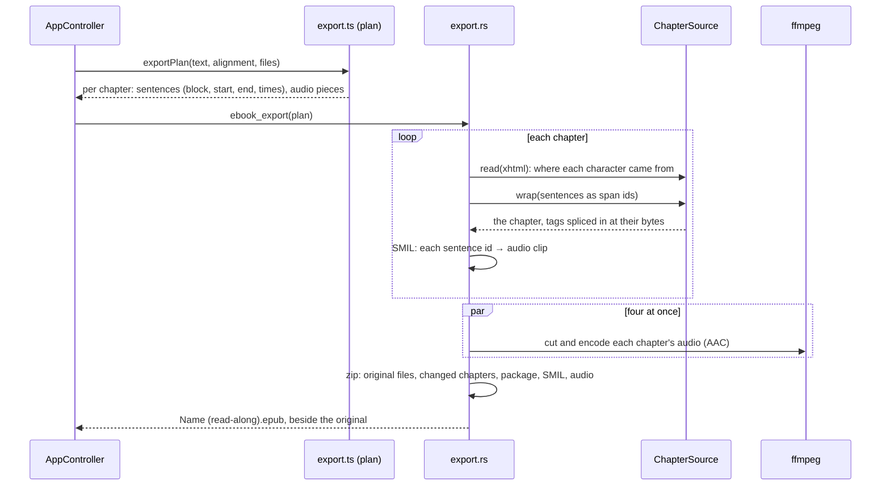

# Architecture

How Ribbon is put together, in pictures. For why it is this way, see
[NORTHSTAR.md](NORTHSTAR.md); for reading and read-along in detail,
[READING.md](READING.md); for the position log, [POSITION-FORMAT.md](POSITION-FORMAT.md).

## 1. The big picture

A Tauri app: a web page (React, TypeScript) in a native window, and Rust
behind it for the work on files. Your library folder is the database:
everything Ribbon learns is a small file in `.ribbon/` beside the books.



**The rules the layers keep:**

| Layer | May | May not |
| --- | --- | --- |
| `core/` | compute: pairing, mapping, parsing records, search | touch files, the network, React or the controller |
| `app/` | own the state, run actions, read and write records through `Host` | draw |
| `host/` | do IO: `tauri.ts` in the app, `browser.ts` for the web build, `node.ts` for tests and tools | decide anything |
| `ui/`, `reader/` | draw the state, call controller actions | change state directly |
| Rust | the per-file heavy work: walking, probing, parsing EPUBs, speech, frames, exports | hold the app's state |

So most of Ribbon's logic is in `core/` and runs in the tests with no app at all.

## 2. Six ways of naming a spot in a book

Most of the reading code converts between these. Knowing which is which is
most of knowing how it works.



- **`BookText`** (`core/reading/booktext.ts`) owns everything about the
  text side: made once per opened book.
- **`Alignment`** (`core/reading/align.ts`) is the only bridge between text
  and time. Everything read-along does is about making it precise.
- **`ChapterSource`** (`src-tauri/src/ebook/source.rs`) is how a place
  becomes bytes of the book's own files, for the export.

## 3. The reading model



The `Ebook` comes from Rust (`ebook/mod.rs` parses the EPUB once and caches
the model in the Ribbon folder). Offsets are UTF-16 code units, as
JavaScript strings count them, so a `TextPlace` indexes a block's text
directly.

A **`Pair`** is one text chapter matched with one audio chapter (or a few
of either). Its `points` are where text and time are known to meet: its two
ends at least, and every checkpoint inside. Between two points, a place
maps by proportion. More points, more precision.

## 4. Where read-along's precision comes from

Each level adds points to the pairs. The reader marks a sentence only
where points are under 20 s apart (`precise()` in `align.ts`).



## 5. Opening a book to read



A book opened again in the same session reuses its `ReadingData` (the
heard places, transcript and fixes kept in memory) and reads none of it again.

### Laying out the pages

The reader's lines are broken by pretext, which measures text on a canvas.
That work runs in a worker, so a long chapter never holds up a tap, a turn
or a scroll:



The worker loads the reader's own faces (`reader/faces.ts`), the same ones the
page draws with, so its lines break exactly as the page would draw them.
Where no worker can measure (no `OffscreenCanvas`: Safari before 16.4), the
engine lays out on the page instead, one chapter per task. A change of text
size, column or justification starts the whole book again.

Scrolling shows the whole book as one column: chapters not laid out yet hold
a height guessed from their length until they arrive. Only the lines within
half a screen of the view are drawn, and a scroll draws again only when it
crosses a half-screen band; where you are reaches the app a few times a
second, not on every scroll event.

A book opens to the page you left at once (`reader/snapshot.ts`): the
chapter's layout and your place in it are kept in the window's storage, and
drawn while the book's text is read and paired with the narration. The same
layout seeds the engine, so the real page needs no layout and replaces the
snapshot without moving. A snapshot made for another window size, other
settings or another version of Ribbon is not used.

## 6. Following the narrator

Five times a second, while the book plays:



A turn or scroll by hand stops following; turning back to the narrator
while it plays starts it again.

## 7. Playing an MP3 from the exact place



The webview's own seek in an MP3 with no seek table guesses by bitrate and
was measured up to two minutes off; this lands within a frame.

## 8. The read-along export



## 9. Files

```text
Your library folder/                 the database: sync it, back it up
  Some Book/
    Some Book.mp3 (or many files)
    Some Book.epub
    Some Book (read-along).epub      an export, if you made one
  .ribbon/
    library.csv, files.csv           the scan's cache
    positions/<device>.ndjson        where you are, per device (POSITION-FORMAT.md)
    bookmarks/, clips/               bookmarks and highlights, with their audio
    chapters/, corrections/          chapters, and your edits to them
    pairing/<book>.csv               text chapters paired with audio by hand
    heard/<book>.csv                 what the narrator was heard saying, and where
    aligned/<book>.csv               the narration transcribed, phrase by phrase
    loudness/, silence/, settings/, edits/, covers/, ebooks.csv

%LOCALAPPDATA%\Ribbon\               this machine only
  settings.json                      app settings, reading places, the speech model
  mirror/                            a local copy of each library's records, for a fast start
  mirror/ebooks/<hash>/              each EPUB's parsed model and images
  mirror/frames/<hash>.bin           each MP3's frame index
  logs/ribbon.log
  models/                            a downloaded speech model
```

Anything in `.ribbon/` is either rebuilt on demand or yours (positions,
bookmarks, corrections, pairing); README.md lists which is which.

## 10. Where to start reading code

| To understand | Read |
| --- | --- |
| How the app holds together | `app/controller.ts` (state at the top, then actions by area) |
| What a book is | `core/types.ts`, `core/scan/group.ts` |
| Places in a book | `core/reading/booktext.ts` |
| Text ↔ time | `core/reading/align.ts` (`alignBook`, `textToMs`, `msToText`) |
| Read-along's transcript | `core/reading/transcript.ts`, `src-tauri/src/speech.rs` |
| The reader on screen | `reader/ReadingView.tsx`, `core/reading/pages.ts`, `reader/typeset.ts`, `reader/layout-engine.ts` |
| Playback | `player/engine.ts`, `src-tauri/src/frames.rs` |
| The EPUB parser | `src-tauri/src/ebook/content.rs` |
| The export | `core/reading/export.ts`, `src-tauri/src/ebook/export.rs`, `source.rs` |
