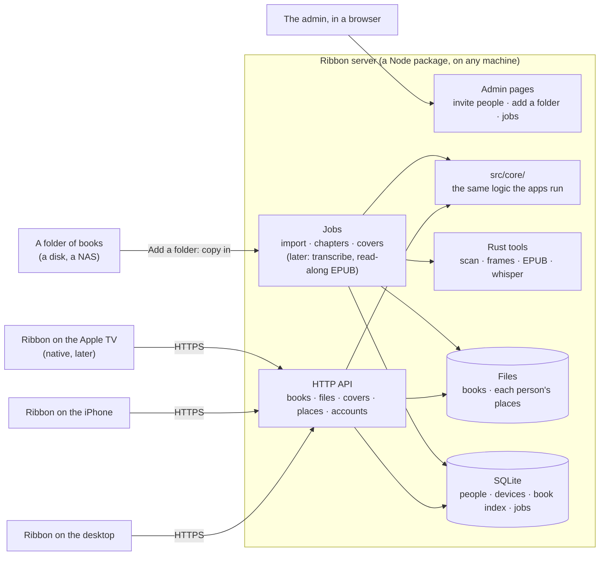

# The Ribbon server

**A design for review, not built yet.** It records what was decided on
2026-10-22 and proposes the rest; the questions still open are in section 12.

## 1. Why a server

Version one kept the library in folders and everything Ribbon learns in
`.ribbon/` beside the books, with no account and no service. That works for
one person on computers that can write to the folder. It stops working on
the devices that matter next:

- **Phones can't prepare books.** iOS runs no ffmpeg, so a phone can't read
  an audiobook's chapters, and it can't transcribe the narration. It relies
  on a computer having done that beside the book first.
- **Phones and shares don't write well.** The iPhone's Files app reaches the
  owner's Samba share read-only. The Mac reaches it but every rename fails
  ("Device error"), so what it learns is lost. One book, Master of Rites,
  ended up paired as one chapter on both.
- **The Apple TV is coming,** and tvOS has no web view: it needs a native
  client talking to something.
- **More than one person.** The owner's brothers want the read-along. Ribbon
  serves one person per app; nobody can keep their own place in a shared
  library.

A server fixes all four at the root: one machine prepares each book once,
keeps everyone's place, and every device, desktop, phone or TV, uses the
finished result.

## 2. What was decided

| Question | Decision |
| --- | --- |
| Use Audiobookshelf as the server, or build Ribbon's own? | **Ribbon's own server**, a Node package anyone can run on a machine of their own. |
| Read the books where they are, or copy them in? | **Copy them onto the server** when a folder is added. |
| A book that's already on the server? | **Never added again.** |
| Files or a database? | **Files for the books and each person's place, and a small SQLite database** for what is metadata. |
| How do people sign in? | **Usernames and passwords.** |
| Who brings people in? | **The admin invites them.** |
| Hosting, privacy, HTTPS? | **The host's business.** The server doesn't depend on Tailscale or any network; the owner runs his behind Tailscale so it isn't on the open internet. |
| Streaming, or keeping books on the device? | **Download before playing** on desktops and phones. The Apple TV streams (section 8). |
| Which clients first? | **The desktop app (Windows and Mac) and the iPhone.** |
| What works first? | **Everyone listens with their own place** (section 11). |
| Above all | **Fast, with no pop-in or layout shift** (section 7). |

The owner's first server is his old T2 MacBook. Nothing in the design
depends on it.

## 3. The big picture



## 4. Built from what Ribbon already is

Most of what the server needs exists, because Ribbon was layered for it
([ARCHITECTURE.md](ARCHITECTURE.md), section 1):

- **`src/core/`** is pure TypeScript with no files or app in it. Scanning
  books into a library, chapters, the position log and its merge, pairing
  text with audio, read-along's alignment: the server runs the same code the
  apps do, so a book is prepared the same way everywhere.
- **`src/host/node.ts`** is a `Host` for Node already: the tests and the
  command line (`npm run ribbon -- scan`) run the scanner on it today.
- **The Rust side** does the per-file work (tags, MP3 frame indexes, EPUB
  models, whisper). The server calls it as a command-line tool built from
  the same crate, the way the dev harness already runs `ebook_json`.
- **The position log** ([POSITION-FORMAT.md](POSITION-FORMAT.md)) was made
  for devices that are often offline: each device appends to its own log,
  and merging needs no referee. The server keeps one set of logs per person
  and merges them with the same code. A phone that listened on a plane sends
  what it appended when it's back; nothing can conflict.

So the server is **a Node package in this repository** (`server/`), sharing
`src/core/` with the apps. Speed comes from where the work runs, not the
language: answering requests and sending files is quick in Node, and
anything heavy (probing, indexing, transcribing) runs in the Rust tools as a
job, never while someone waits on a request.

## 5. What the server keeps

**Files** for what is content or yours: the books themselves, and each
person's place, in the same formats as `.ribbon/`, readable and easy to take
away. **SQLite** for what is metadata: who can sign in, which devices,
what books exist and how to find them fast, the jobs.

```text
<server data>/                      wherever the host puts it
  ribbon.db                         SQLite: people, invites, devices, the book
                                    index, cover sizes and colours, jobs
  books/<book-id>/
    audio files                     copied in, never changed
    book.epub                       copied in, if the book has one
    covers/                         the cover at each size the apps draw it
    records/                        chapters, corrections, pairing, frames,
                                    heard, aligned: what .ribbon/ holds today
  people/<id>/
    places/<device>.ndjson          the position log, one file per device
    settings.json                   speed per book, reading settings
  logs/server.log
```

**Copying in** (decided): adding a folder copies its books into `books/`.
The server then writes only to its own disk, so nothing depends on a share
accepting writes, and the books stay put when the NAS is away. The cost is
disk space; the host chooses where the data folder lives.

**Never twice** (decided): before copying a book, the server looks it up in
the book index by what identifies it: its identifiers (ISBN, ASIN) when it
has them, else a fingerprint of its audio files (their sizes and a hash of
each file's first and last megabyte), and for an EPUB, its package
identifier and a hash. A book already there is skipped and reported as
such. An EPUB found later for an audiobook already on the server joins it.

## 6. Accounts

- **People:** an admin and members. **The admin invites people** from the
  admin pages: an invite is a link with a one-time code, good for a few days,
  where the person picks their name and password.
- **Passwords** are stored as salted hashes (scrypt, built into Node, so no
  native module to build).
- **Devices:** signing in on a device gives it a long-lived token, kept by
  the app ("Ribbon on Khalid's iPhone"). The admin pages list each person's
  devices, and any of them can be signed out. A phone stays signed in.
- **HTTPS is the host's job.** The server speaks plain HTTP and expects to sit
  behind whatever the host uses: a reverse proxy such as Caddy, Tailscale
  Serve, a tunnel. It refuses passwords over plain HTTP from anywhere but the
  same machine, and the iPhone requires HTTPS anyway (App Transport
  Security), so a server reached from a phone has to have it.
- **Download links:** a download is a plain link with a short-lived signed
  token in it, so the OS's own downloader can fetch it without the app's
  sign-in header.

## 7. Fast, with no pop-in

The rule: **nothing on screen moves or appears late because of the server.**

- **The whole library in one request**, with what the shelf needs to lay
  itself out: each book's cover aspect ratio and its dominant colour (Ribbon
  already takes a tint from each cover). The shelf is drawn at its final size
  and tinted before any image arrives, so covers fade in where they belong
  instead of shifting the page.
- **Covers made once, at the sizes the apps draw them**, on the server, at 1x,
  2x and 3x. Their URLs carry a hash of the picture, so they never change and
  are sent with `Cache-Control: immutable`.
- **Covers kept on each device.** The desktop already mirrors covers locally
  (`mirror/covers`). Every app keeps them on disk, so from the second launch
  on, every cover is drawn from the device.
- **The library list is cached on the device too**, and drawn at once on
  launch; the server answers "nothing changed" (an ETag) in a few
  milliseconds, or sends only what did.
- **Changes are pushed** (server-sent events): a book added, your place moved
  on another device. No polling.
- **No waiting on work.** Importing, probing, covers and (later) transcribing
  are jobs that run in the background; a request only ever reads what's
  already made.

## 8. Getting books onto devices

**Desktops and phones: download before playing** (decided). Opening a book
for the first time downloads it to the device: its audio, its EPUB, its
records and its covers, with progress on the cover. It plays and reads from
the device from then on, so listening never depends on the network, in the
car or on a plane.

- **The app's player needs no change for this:** a downloaded book is files on
  the device, played as a folder's books are today, exact MP3 seeking
  included.
- **Downloads go on in the background** where the system allows it. On the
  iPhone that needs a native download (iOS's background transfers), not the
  web view's: work for milestone 1.
- **Space:** "Remove from this device" on any book; places and bookmarks stay
  on the server. When finished books leave a phone is section 12.
- **Places and bookmarks always sync**, whatever is downloaded.

**The Apple TV streams.** tvOS gives an app almost no lasting storage, only
caches the system may clear at any time, so a TV can't keep a book. It
streams the audio from the server, which therefore also serves audio with
Range requests and starts an MP3 at the exact frame (`frames.rs` in the app
today), and it keeps covers in its cache.

## 9. The API (first milestone)

JSON over HTTP. A sketch, to be settled in code review:

| Request | What it does |
| --- | --- |
| `POST /api/sign-in` `{name, password, device}` | Returns a device token. |
| `POST /api/invites/:code` `{name, password}` | Accepts an invite. |
| `GET /api/books` | The library in one answer: titles, authors, narrators, series, length, chapters, whether there's an EPUB, each cover's hash, aspect ratio and colour. ETag. |
| `GET /api/books/:id` | One book: its files, chapters, parts and records. |
| `GET /covers/:hash-:width.jpg` | A cover at one size. Immutable. |
| `GET /api/books/:id/files/:file` | A file of the book, with Range requests, for downloads (and, later, the TV's streaming). |
| `GET /api/places?after=` | Your position records from every device, newer than what this device has. |
| `POST /api/places` | Records this device appended (where you are, bookmarks, finished), in a batch. |
| `GET /api/events` | Server-sent events: your place moved on another device, a book was added. |

The admin pages have their own: invites, people, devices, adding a folder,
and the jobs that follow.

## 10. The apps

- **A server is a kind of library**, next to a folder. "Add a folder" gets a
  sibling, "Connect to a server": its address, your name and password.
- In the app, a `ServerLibrary` gives the controller what `LibraryService`
  gives it for a folder (books, records, places) through the API instead of
  files, and keeps downloaded books in the app's own folder.
- **Your place needs no new machinery.** `PositionKeeper` already keeps every
  place on the device first and sends it on when it can; for a server,
  "beside the books" becomes `POST /api/places`. Offline, places wait on the
  device and go when it's back.
- **The Apple TV** gets a native client on the same API, after milestone 1.
- **The admin pages** are web pages the server serves, in Ribbon's own design.

Folders stay for people without a server; nothing about them changes.

## 11. Milestones

**1. Everyone listens with their own place.**

- The server as a Node package: invites, sign-in, people and devices, and the
  admin pages for those and for adding a folder.
- Adding a folder: scan it with the existing scanner, show what was found and
  what's already there, copy the new books in, read their chapters (ffprobe
  runs on the server), make their covers.
- The API in section 9, with the caching in section 7.
- Ribbon on the desktop (Windows and Mac) and the iPhone: connect to a
  server, show its library with no pop-in, download a book, play and read it
  from the device, each person's place kept and synced across their devices.
- Done when: the owner and a brother each listen to the same book on their
  phones, each from their own place, and the owner's place follows him from
  the phone to the desktop.

**2. Read-along prepared on the server.** The server pairs each book's text
with its audio and transcribes the narration with whisper as a job, and the
read-along comes down with the book (its transcript, or a finished read-along
EPUB with Media Overlays), so no device does any of it. Whisper's speed on the
host gets measured first: on an Intel CPU a long book may take an hour or two,
which is fine overnight.

**3. The Apple TV** (streaming), Android, bookmarks and highlights per
person, and what the first two milestones teach.

## 12. Still to decide

1. **When finished books leave a phone**: at once, after a few days, or only
   when space runs short.
2. **Whether a download can start playing before it's done**, once the first
   minutes are down. Download before playing is the decision; this would only
   shorten the wait the first time a long book is opened.
3. **NORTHSTAR.** "Not a server" and "Nothing to sign in to" no longer hold.
   A proposal for the new lines, to agree before this is built:
   - *Your own server, your own people, nothing in the cloud.* Ribbon runs on
     a machine you choose, for the people you invite. No store, no tracking,
     no one else's service.
   - *Your place is still a file.* Each person's place is kept as the
     position log on that machine, readable, and theirs to take away.
   - *Folders still work.* Ribbon without a server is the app it was.
