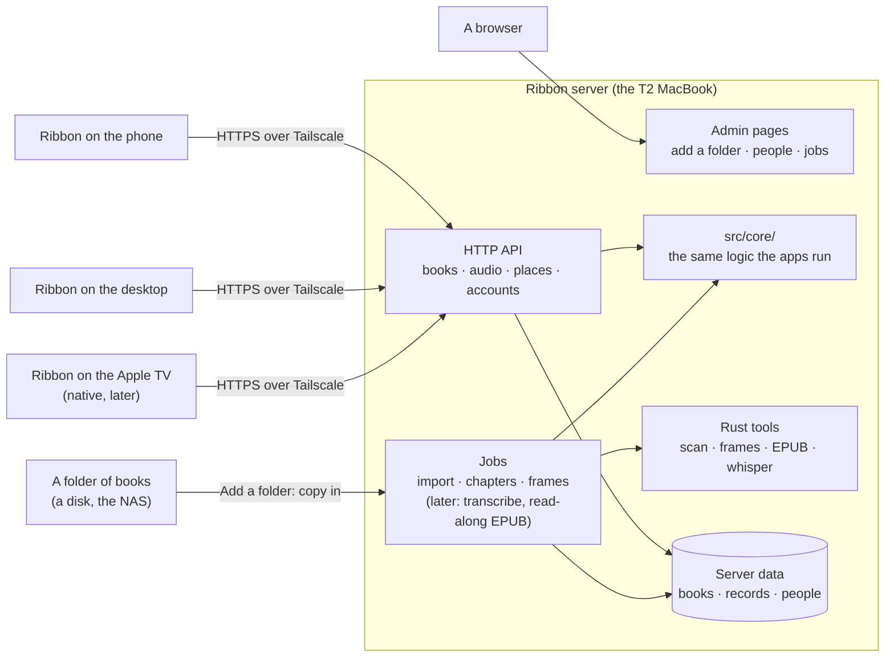

# The Ribbon server

**A design for review, not built yet.** It records what was decided on
2026-10-22 and proposes the rest; the questions still open are in section 10.

## 1. Why a server

Version one kept the library in folders and everything Ribbon learns in
`.ribbon/` beside the books, with no account and no service. That works for
one person on computers that can write to the folder. It stops working on
the devices that matter next:

- **Phones can't prepare books.** iOS runs no ffmpeg, so a phone can't read
  an audiobook's chapters, and it can't transcribe the narration. It relies
  on a computer having done that beside the book first.
- **Phones and shares don't write well.** The iPhone's Files app reaches the
  owner's Samba share read-only. The Mac reaches it but every rename fails
  ("Device error"), so what it learns is lost. One book, Master of Rites,
  ended up paired as one chapter on both.
- **The Apple TV is coming,** and tvOS has no web view: it needs a native
  client talking to something.
- **More than one person.** The owner's brothers want the read-along. Ribbon
  serves one person per app; nobody can keep their own place in a shared
  library.

A server fixes all four at the root: one machine prepares each book once,
keeps everyone's place, and every device, phone, desktop or TV, uses the
finished result.

## 2. What was decided

| Question | Decision |
| --- | --- |
| Use Audiobookshelf as the server, or build Ribbon's own? | **Ribbon's own server.** |
| Read the books where they are, or copy them in? | **Copy them onto the server** when a folder is added. |
| How do people sign in? | **Usernames and passwords.** |
| What works first? | **Everyone listens with their own place** (section 9). |

The first server is the owner's old T2 MacBook (Intel, macOS), reached over
Tailscale, until something better comes along.

## 3. The big picture



## 4. Built from what Ribbon already is

Most of what the server needs exists, because Ribbon was layered for it
([ARCHITECTURE.md](ARCHITECTURE.md), section 1):

- **`src/core/`** is pure TypeScript with no files or app in it. Scanning
  books into a library, chapters, the position log and its merge, pairing
  text with audio, read-along's alignment: the server runs the same code the
  apps do, so a book is prepared the same way everywhere.
- **`src/host/node.ts`** is a `Host` for Node already: the tests and the
  command line (`npm run ribbon -- scan`) run the scanner on it today.
- **The Rust side** does the per-file work (tags, MP3 frame indexes, EPUB
  models, whisper). The server calls it as a command-line tool built from
  the same crate, the way the dev harness already runs `ebook_json`.
- **The position log** ([POSITION-FORMAT.md](POSITION-FORMAT.md)) was made
  for devices that are often offline: each device appends to its own log,
  and merging needs no referee. The server keeps one set of logs per person
  and merges them with the same code. A phone that listened on a plane sends
  what it appended when it's back; nothing can conflict.

So the proposal is **a Node server in TypeScript, in this repository**
(`server/`), sharing `src/core/` with the apps, and calling the Rust tools
for heavy work. A server in Rust was considered: it would mean porting the
pairing, alignment and position log from TypeScript, and keeping two copies
of the logic that decides where you are in a book.

## 5. What the server keeps

Files, as Ribbon always has, in the same formats as `.ribbon/`, so a
person's data stays readable and can be taken away. No database to start
with; one is easy to add later if something needs it.

```text
<server data>/                      on the T2 MacBook, its own disk or an external one
  books/<book-id>/
    audio files                     copied in, never changed
    book.epub                       copied in, if the book has one
    cover.jpg
    records/                        chapters, corrections, pairing, frames,
                                    heard, aligned: what .ribbon/ holds today
  people/<name>/
    places/<device>.ndjson          the position log, one file per device
    settings.json                   speed per book, reading settings
  people.csv                        name, role (admin or member), password hash
  devices.csv                       each signed-in device: who, its name, a token hash
  server.json                       the server's own settings
  logs/server.log
```

**Copying in** (decided): adding a folder copies its books into
`books/`. The server then writes only to its own disk, so nothing depends on
a share accepting writes, and the books stay put when the NAS is away. The
cost is disk space: the T2 MacBook's internal drive may not hold the whole
library, so the data folder can live on an external drive (section 10).

## 6. Accounts

- **People:** an admin (the owner) and members. The admin adds people from
  the admin pages and gives each a first password, which they can change.
- **Passwords** are stored as salted hashes (scrypt, built into Node, so no
  native module to build). They're only ever sent over HTTPS.
- **Devices:** signing in on a device gives it a long-lived token, kept by
  the app ("Ribbon on Khalid's iPhone"). The admin pages list each person's
  devices, and any of them can be signed out. A phone stays signed in.
- **HTTPS over Tailscale:** the server listens on the tailnet only, with
  Tailscale's own certificate for its `*.ts.net` name, so the phone and the
  TV get real HTTPS with nothing to configure.
- **Audio URLs:** an audio element can't send a sign-in header, so each
  audio link carries a short-lived signed token instead.

## 7. The API (first milestone)

JSON over HTTPS. A sketch, to be settled in code review:

| Request | What it does |
| --- | --- |
| `POST /api/sign-in` `{name, password, device}` | Returns a device token. |
| `GET /api/books` | The library: titles, authors, narrators, series, length, cover, chapters, whether there's an EPUB. One request, not one per book. |
| `GET /api/books/:id` | One book: its files, chapters and parts. |
| `GET /api/books/:id/cover` | The cover. |
| `GET /api/books/:id/audio/:file?ms=` | The audio, with Range requests. An MP3 starts at the exact frame for `ms`, as `frames.rs` does in the app today. |
| `GET /api/books/:id/ebook` | The EPUB. |
| `GET /api/places?after=` | Your position records from every device, newer than what this device has. |
| `POST /api/places` | Records this device appended (where you are, bookmarks, finished), in a batch. |
| `GET /api/events` | Server-sent events: another of your devices moved your place, a book was added. |

The admin pages have their own API: people, devices, adding a folder, and
the jobs that follow.

## 8. The apps

- **A server is a kind of library**, next to a folder. "Add a folder" gets a
  sibling, "Connect to a server": its address, your name and password.
- In the app, a `ServerLibrary` gives the controller what `LibraryService`
  gives it for a folder (books, records, places) through the API instead of
  files. The player streams from the server's audio URLs.
- **Your place on the phone needs no new machinery.** `PositionKeeper` already
  keeps every place on the device first and sends it on when it can; for a
  server, "beside the books" becomes `POST /api/places`. Offline, places wait
  on the phone and go when it's back.
- **The Apple TV** gets a native client on the same API, later.
- **The admin pages** are web pages the server serves, in Ribbon's own design.
  Because the app already runs in a browser against an HTTP host (the dev
  harness), the server could also serve Ribbon itself to a browser. Worth
  deciding, not needed first (section 10).

Folders stay for people without a server; nothing about them changes.

## 9. Milestones

**1. Everyone listens with their own place.**

- The server on the T2 MacBook: sign-in, people and devices, the admin pages
  for those and for adding a folder.
- Adding a folder: scan it with the existing scanner, show what was found,
  copy the chosen books in, read their chapters (ffprobe runs on the server)
  and index their MP3 frames.
- The API in section 7.
- Ribbon on the desktop and the phone: connect to a server, list its books,
  stream with exact seeking, each person's place kept and synced across their
  devices.
- Done when: the owner and a brother each listen to the same book on their
  phones, each from their own place, and the owner's place follows him from
  the phone to the desktop.

**2. Read-along prepared on the server.** The server pairs each book's text
with its audio and transcribes the narration with whisper as a job, then
serves the transcript, or a finished read-along EPUB with Media Overlays, so
phones and the TV get exact read-along without doing any of it. Books can be
downloaded to a phone for offline listening and reading. The T2's whisper
speed gets measured first: on an Intel CPU a long book may take an hour or
two, which is fine overnight.

**3. The Apple TV**, bookmarks and highlights per person, and what the first
two milestones teach.

## 10. Still to decide

1. **Where the server's data lives** on the T2 MacBook: its internal drive, or
   an external one, given the library's size.
2. **Node or Rust** for the server (section 4 proposes Node).
3. **Whether the server also serves Ribbon to a browser**, so anyone on the
   tailnet can listen without installing anything.
4. **How adding a folder treats a book already on the server**: skip it,
   replace it, or ask.
5. **NORTHSTAR.** "Not a server" and "Nothing to sign in to" no longer hold.
   A proposal for the new lines, to agree before this is built:
   - *Your own server, your own accounts, nothing in the cloud.* Ribbon runs
     on a machine you own, for the people you choose. No store, no tracking,
     no one else's service.
   - *Your place is still a file.* Each person's place is kept as the
     position log on that machine, readable, and yours to take away.
   - *Folders still work.* Ribbon without a server is the app it was.
