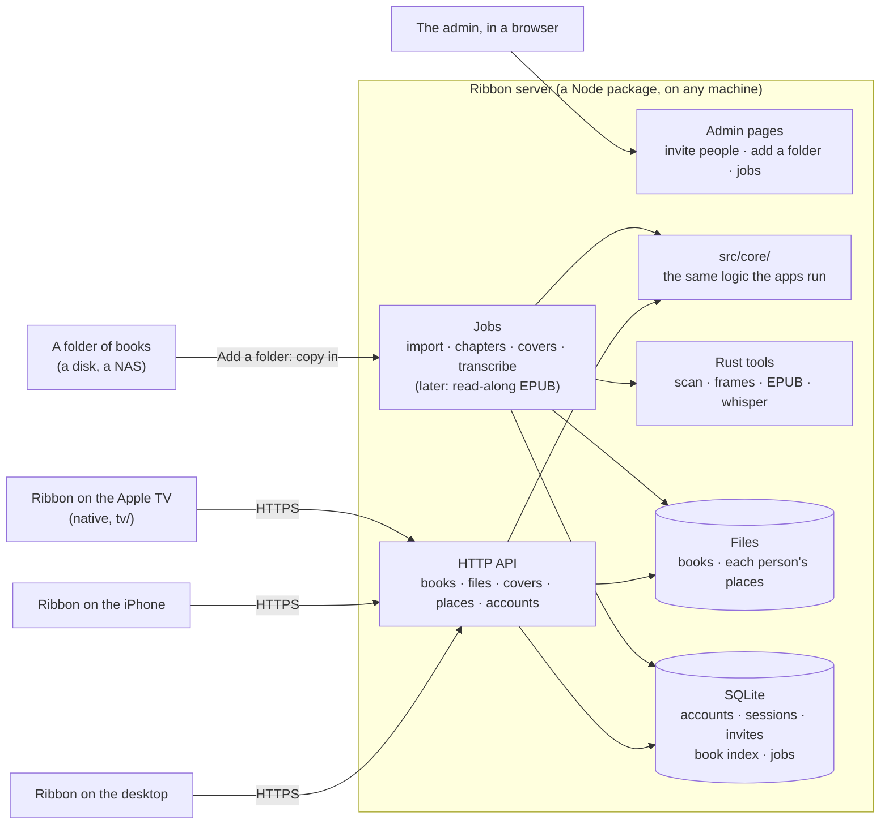

# The Ribbon server

**The design for Ribbon's server, agreed on 2026-10-22, not built yet.**
Section 2 lists what was decided; the one question still open is in
section 13. Code review settles the details.

## 1. Why a server

Version one kept the library in folders and everything Ribbon learns in
`.ribbon/` beside the books, with no account and no service. That works for
one person on computers that can write to the folder. It stops working on
the devices that matter next:

- **Phones can't prepare books.** iOS runs no ffmpeg, so a phone can't read
  an audiobook's chapters, and it can't transcribe the narration. It relies
  on a computer having done that beside the book first.
- **Phones and shares don't write well.** The iPhone's Files app reaches the
  owner's Samba share read-only. The Mac reaches it but every rename fails
  ("Device error"), so what it learns is lost. One book, Master of Rites,
  ended up paired as one chapter on both.
- **The Apple TV is coming,** and tvOS has no web view: it needs a native
  client talking to something.
- **More than one person.** The owner's brothers want the read-along. Ribbon
  serves one person per app; nobody can keep their own place in a shared
  library.

A server fixes all four at the root: one machine prepares each book once,
keeps everyone's place, and every device, desktop, phone or TV, uses the
finished result.

## 2. What was decided

| Question | Decision |
| --- | --- |
| Use Audiobookshelf as the server, or build Ribbon's own? | **Ribbon's own server**, a Node package anyone can run on a machine of their own. |
| Read the books where they are, or copy them in? | **Copy them onto the server** when a folder is added. |
| A book that's already on the server? | **Never added again.** |
| Files or a database? | **Files for the books; SQLite for everything else**, each person's places included (they come back as a file in the position-log format whenever asked). Decided again on 2026-10-22, after keeping places as files on the server and copying them onto every device proved the fiddly part. |
| How do people sign in? | **Usernames and passwords, with [Better Auth](https://better-auth.com).** |
| Who brings people in? | **The admin invites them.** |
| Hosting, privacy, HTTPS? | **The host's business.** The server doesn't depend on Tailscale or any network; the owner runs his behind Tailscale so it isn't on the open internet. |
| Streaming, or keeping books on the device? | **Download before playing** on desktops and phones. The Apple TV streams (section 8). |
| A device running out of space? | **Check before every download, and let the person choose** what to remove, or not to download. Nothing is removed on its own. |
| While a book is being prepared? | **Only what's exact is offered** (section 9): listening and reading never wait; moving between them goes by chapter until the narration is transcribed, then by sentence. |
| Which clients first? | **The desktop app (Windows and Mac) and the iPhone.** |
| What works first? | **Everyone listens with their own place** (section 12). |
| The web framework | **Fastify.** |
| NORTHSTAR | **"Not someone else's service", "Your place is yours", "Folders still work"**, now in [NORTHSTAR.md](NORTHSTAR.md) in place of "Not a server" and "Nothing to sign in to". |
| Above all | **Fast, with no pop-in or layout shift** (section 7), and HTTP caching used wherever it helps. |

The owner's first server is his old T2 MacBook. Nothing in the design
depends on it.

## 3. The big picture



## 4. Built from what Ribbon already is

Most of what the server needs exists, because Ribbon was layered for it
([ARCHITECTURE.md](ARCHITECTURE.md), section 1):

- **`src/core/`** is pure TypeScript with no files or app in it. Scanning
  books into a library, chapters, the position log and its merge, pairing
  text with audio, read-along's alignment: the server runs the same code the
  apps do, so a book is prepared the same way everywhere.
- **`src/host/node.ts`** is a `Host` for Node already: the tests and the
  command line (`npm run ribbon -- scan`) run the scanner on it today.
- **The Rust side** does the per-file work (tags, MP3 frame indexes, EPUB
  models, whisper). The server calls it as a command-line tool built from
  the same crate, the way the dev harness already runs `ebook_json`. Built
  for EPUBs: `ribbon-ebook` (src-tauri/ebook), for read-along on the TV.
- **The position log** ([POSITION-FORMAT.md](POSITION-FORMAT.md)) was made
  for devices that are often offline: each device appends to its own log,
  and merging needs no referee. The server keeps one set of logs per person
  and merges them with the same code. A phone that listened on a plane sends
  what it appended when it's back; nothing can conflict.

So the server is **a Node package in this repository** (`server/`), on
**Fastify**, sharing `src/core/` with the apps. Speed comes from where the
work runs as much as from the framework: answering requests and sending
files is quick in Node, and anything heavy (probing, indexing, transcribing)
runs in the Rust tools as a job, never while someone waits on a request.

## 5. What the server keeps

**Files** for the books themselves. **SQLite** for the rest: who can sign
in, which devices, what books exist and how to find them fast, the jobs, and
each person's places. A person's places are the position log
([POSITION-FORMAT.md](POSITION-FORMAT.md)), one row per record a device
appended, kept once however often a retry sends it, and `GET
/api/places/export` hands the whole log back as a file in that format:
readable, and easy to take away.

```text
<server data>/                      wherever the host puts it
  ribbon.db                         SQLite: Better Auth's people and sessions,
                                    invites, the book index, cover sizes and
                                    colours, jobs, each person's places, and
                                    every book's sentences, for search
  books/<book-id>/
    audio files                     copied in, never changed
    book.epub                       copied in, if the book has one
    covers/                         the cover at each size the apps draw it
    records/                        chapters, corrections, pairing, frames,
                                    heard, aligned: what .ribbon/ holds today
  people/<id>/
    settings.json                   speed per book, reading settings
  logs/server.log
```

**Copying in** (decided): adding a folder copies its books into `books/`.
The server then writes only to its own disk, so nothing depends on a share
accepting writes, and the books stay put when the NAS is away. The cost is
disk space; the host chooses where the data folder lives.

**Never twice** (decided): before copying a book, the server looks it up in
the book index by what identifies it: its identifiers (ISBN, ASIN) when it
has them, else a fingerprint of its audio files (their sizes and a hash of
each file's first and last megabyte), and for an EPUB, its package
identifier and a hash. A book already there is skipped and reported as
such. An EPUB found later for an audiobook already on the server joins it.

## 6. Accounts

Accounts are **[Better Auth](https://better-auth.com)** (decided), rather
than written by hand: it has a [Fastify integration](https://better-auth.com/docs/integrations/fastify),
keeps its tables in the same SQLite database, and hashes passwords with
scrypt. The plugins it needs:

- **username:** people sign in with a name and a password.
- **admin:** the admin pages list people and their sessions, change roles,
  and sign anyone out.
- **bearer:** the desktop and phone apps send their session as a token in a
  header rather than a cookie.

How Ribbon uses it:

- **People:** an admin and members. **The admin invites people** from the
  admin pages: an invite is a link with a one-time code, good for a few days,
  where the person picks their name and password. Signing up is closed to
  everyone else: a check on Better Auth's sign-up lets it through only with a
  valid code, and spends the code.
- **Devices are sessions.** Signing in on a device makes a long-lived session
  for it, named for the device ("Ribbon on Khalid's iPhone"), kept by the app.
  The admin pages list each person's sessions, and any of them can be signed
  out. A phone stays signed in.
- **HTTPS is the host's job.** The server speaks plain HTTP and expects to sit
  behind whatever the host uses: a reverse proxy such as Caddy, Tailscale
  Serve, a tunnel. It refuses passwords over plain HTTP from anywhere but the
  same machine, and the iPhone requires HTTPS anyway (App Transport
  Security), so a server reached from a phone has to have it.
- **Download links:** a download is a plain link with a short-lived signed
  token in it, so the OS's own downloader can fetch it without the app's
  sign-in header.

## 7. Fast, with no pop-in

The rule: **nothing on screen moves or appears late because of the server.**

- **The whole library in one request**, with what the shelf needs to lay
  itself out: each book's cover aspect ratio and its dominant colour (Ribbon
  already takes a tint from each cover). The shelf is drawn at its final size
  and tinted before any image arrives, so covers fade in where they belong
  instead of shifting the page.
- **Covers made once, at the sizes the apps draw them**, on the server, at 1x,
  2x and 3x. Their URLs carry a hash of the picture, so they never change and
  are sent with `Cache-Control: immutable`.
- **Covers kept on each device.** The desktop already mirrors covers locally
  (`mirror/covers`). Every app keeps them on disk, so from the second launch
  on, every cover is drawn from the device.
- **The library list is cached on the device too**, and drawn at once on
  launch; the server answers "nothing changed" in a few milliseconds, or
  sends only what did.
- **What changes often never rides with what doesn't.** Titles, covers,
  chapters and the rest change when a book is added or edited; places,
  progress and "finished" change every few seconds while someone listens.
  So places have their own request, and nothing about where anyone is goes
  into the library, a book's details or its records. Those answers stay the
  same for days and are almost always a `304`; progress on the shelf is
  worked out on the device from the places it already has.
- **Changes are pushed** (server-sent events): a book added, your place moved
  on another device. No polling.
- **No waiting on work.** Importing, probing, covers and (later) transcribing
  are jobs that run in the background; a request only ever reads what's
  already made.

**HTTP caching, wherever it helps:**

| What | Headers | So that |
| --- | --- | --- |
| Covers | `Cache-Control: private, max-age=31536000, immutable`, a hash in the URL | A cover is fetched once per device, ever. A new picture is a new URL. |
| The library, a book's details, its records | `ETag`, `Cache-Control: private, no-cache`; the app sends `If-None-Match` | The device asks every time and almost always gets `304 Not Modified`, with no body. |
| A book's files (audio, EPUB) | `ETag` and `Last-Modified` (files never change once copied in), `Accept-Ranges: bytes`; the app resumes with `Range` and `If-Range` | A download that stopped carries on from where it was, and starts over only if the file really changed. |
| Your places | `GET /api/places?after=` with the last record this device has | Only new records travel, never the whole log. |
| JSON answers | Compressed (Brotli or gzip, as the app accepts) | The library list for thousands of books stays small. |

`private` keeps anything behind a sign-in out of shared caches; a proxy in
front of the server never stores one person's answers for another.

## 8. Getting books onto devices

**Desktops and phones: download before playing** (decided). Opening a book
for the first time downloads it to the device: its audio, its EPUB, its
records and its covers, with progress on the cover. It plays and reads from
the device from then on, so listening never depends on the network, in the
car or on a plane.

- **The app's player needs no change for this:** a downloaded book is files on
  the device, played as a folder's books are today, exact MP3 seeking
  included.
- **Downloads go on in the background** where the system allows it. On the
  iPhone that needs a native download (iOS's background transfers), not the
  web view's: work for milestone 1.
- **Space, checked before every download** (decided). The app compares the
  book's size (the server knows it) with the space free on the device,
  leaving a margin. With enough room, the download starts. Without it,
  nothing is removed on its own: the app says how much is needed and lists
  the books already on the device with their sizes, finished ones first,
  and the person picks which to remove, or not to download. "Remove from this
  device" is on every downloaded book too. Places and bookmarks stay on the
  server either way. Reading the free space needs a small native call on each
  system (Rust on the desktop, the iOS storage API on the phone).
- **Places and bookmarks always sync**, whatever is downloaded.

**The Apple TV streams.** tvOS gives an app almost no lasting storage, only
caches the system may clear at any time, so a TV can't keep a book. It
streams the audio from the server, with Range requests, and keeps covers in
its cache. Apple's player can't send a sign-in header, so it sends the
session's cookie. It never seeks in an MP3: it seeks one with no seek table
by its average bitrate, minutes off in a long VBR book. It asks for the file
`?ms=` the moment instead, and the server sends it from that moment's frame
(`ribbon-frames`, the app's own `frames.rs` index), to play from its own 0.

Built (tv/README.md): the TV can neither parse an EPUB nor pair it with the
narration, so the server does both, once, with the apps' own code (the
`ribbon-ebook` command and `src/core/reading/`), and hands it the book's
paragraphs with when each sentence is read. It keeps no position log either:
it asks the server where the person is in a book, as a sentence, and tells it
where it is as it plays; the server writes that into the TV's log as any app
would. Its bookmarks are whole sentences, which the server writes as the
desktop writes words selected in its reader (POSITION-FORMAT.md, section 3.4),
so they're one bookmark with the desktop's, on every device. Its listening
counts as the desktop's does: each stretch opens a listen-through as it
starts and is kept as a session as it ends (unless the person turned
sessions off on the TV), and a book played to its end closes its
listen-through, which is how the TV's end of a book knows when it was
started and how long it took on every device. Its screen of passages, while
a book is paused, is every bookmark's words from every book.

## 9. From added to ready

A book becomes usable in stages, and **each stage offers only what it makes
exact** (decided). Nothing is guessed silently: what isn't exact yet isn't
offered, and the book says what it's waiting for.

| Stage (on the server) | How long | Listen | Read | Move between them |
| --- | --- | --- | --- | --- |
| Copied in, chapters read, covers made | minutes | yes | | |
| EPUB parsed | seconds | yes | yes | |
| Text paired with audio, by chapter | seconds | yes | yes | |
| Narration transcribed whole, by a computer with a graphics card | under an hour a book | yes | yes | **any sentence, with the highlight** |

- **Listening and reading never wait for read-along.** A book can be
  listened to as soon as its audio is in, and read as soon as its EPUB is.
- **Read-along waits for the whole transcript** (#152). Until a book's
  narration is transcribed whole, every device opens it to read only, at
  the person's place: no sentence marked, no pages following the narrator,
  no "Listen from here". A guess by chapter is never shown as the
  sentence being read. A book with its own Media Overlay reads along at
  once.
- **Transcribed,** everything read-along does is offered.
- **The book says where it stands** as it opens on the TV: "Reading only
  for now: read-along comes once the narration is transcribed, 34% so
  far".
- **Devices catch up on their own.** A book downloaded at an earlier stage
  gets the rest when it's ready: the server pushes an event, and the device
  fetches only the new records (the transcript, the pairing), which are
  small.
- **Transcribed by a computer with a graphics card, one transcript a book**
  (#152). The server transcribes nothing: its processor is too slow (on a
  4-core virtual machine, 0.8 times as fast as the book plays with whisper
  base, 0.22 with small), and two machines writing one transcript is how a
  failure stayed in one through deleting the book and adding it again. The
  admin's Mac or PC, signed in as the admin with a speech model, works
  through the books still missing minutes (`GET /api/library/transcripts`),
  one at a time, while Ribbon is open: it downloads a book it hasn't for the
  while, transcribes it start to end (src/app/transcribing.ts, whisper small
  with each word's time), and sends it whole (`PUT
  /api/books/:id/transcript`), kept in place of what the book had. One that
  isn't whole is refused, and a piece of one is never taken. It's placed
  in the book's text by what was said in it as it comes in, and each one
  kept before is placed once when the server starts
  (`server/src/library/place.ts`, READING.md, #163). Each minute
  says which model heard it, and only those count: one from before that
  was heard the old way, perhaps by the server's processor, perhaps a clip
  that failed (#152), so it's heard again. A transcript in a
  folder's records isn't carried in. What was heard at chapter starts
  still comes from devices (`POST /api/books/:id/records/heard`), merged.
- **What a book came without is filled in** from its own files, as a job
  after it's added, and when the server starts for books added before
  (`server/src/library/hydrate.ts`). Its description is its EPUB's
  (`dc:description`), when it has none. Chapters its files only number
  ("Chapter 1" to "Chapter 37", the credits counted among them) are named
  from the EPUB's contents by the pairing (READING.md, section 6), and
  named again when what they came from changes: a transcript coming in
  confirms more of them. Nothing is looked up anywhere else, and nothing set
  by hand is replaced: a description is filled in only where there's none,
  and a book with a chapter named by hand keeps all its names. `book.json`
  says what was filled in (`filled`). A device that downloads the book gets
  the names after the hand corrections, as the one corrections record it
  keeps beside the book; the TV gets the chapters named.
- **A book whose text and audio don't pair** (a different edition, a missing
  chapter) is flagged on the admin pages for a person to fix. It's never
  offered as read-along on a guess.
- **No book stays by chapter unnoticed** (built). A read-along reads by
  sentence when no stretch of narration goes unmarked for more than a
  minute, as it's felt while listening (#163): a stretch with nothing
  marked counts only where the transcript shows the narrator speaking, so
  credits, music and pages nobody reads don't (`readsBySentence`,
  src/core/reading/readalong.ts). Otherwise the TV says how long it drops
  out for as the book opens. Without a transcript, it's the share of
  sentences placed, at least 90% (`BY_SENTENCE`).
  The server keeps where each book stands as it makes its read-along, and
  lists every book for the admin, the ones that need a person first
  (`GET /api/library/readalong`, `stateOf` in
  server/src/library/readalong.ts):
  - flagged: transcribed whole, and still not to the sentence;
  - unpaired: its chapters didn't pair, so nothing heard can be placed;
  - unreadable: its EPUB can't be read;
  - waiting for a computer with a graphics card to transcribe it whole;
  - by sentence.

## 10. The API (first milestone)

JSON over HTTP. A sketch, to be settled in code review:

| Request | What it does |
| --- | --- |
| `/api/auth/*` | Better Auth's own routes: sign up with an invite code, sign in with a name and password, sign out, sessions. |
| `POST /api/invites` | (Admin) Makes an invite: a one-time code and its link. |
| `GET /api/books` | The library in one answer: titles, authors, narrators, series, length, size, whether there's audio and an EPUB, each cover's hash, aspect ratio and colour, and the ids of books the admin deleted. No places or progress in it, so its ETag holds for days. Chapters come with a book's details. |
| `GET /api/books/:id` | One book: its files, chapters, parts and records. |
| `GET /api/series` | The library's series, each with its books in order: a book's number in it, its title as the list shows it ("The Solar War", not "The Solar War: Siege of Terra: The Horus Heresy, Book 1"), and whether it's on the shelf. Series are rows of the server's database (`series`, `series_book`), the same for every device and person. The server finds them when books arrive, by the desktop's rules (`src/core/series.ts`: a series tag, else a series named in the titles); after that they're what people make of them. The desktop and the iPhone show a server's series as it keeps them, cached beside its books (`server-series.json`), and never find their own for it; a server from before series answers 404 and they do. Revalidated by ETag. |
| `POST /api/series`, `PUT /api/series/:id`, `DELETE /api/series/:id` | (Admin) Makes, changes or deletes a series: its name and its books in order, each with its number, title and whether it's on the shelf. A book taken out of a series, and a series deleted, are never found again; a book put in a series leaves the one it was in; a number or title left out keeps the one it has. The desktop's and the iPhone's series editing saves here for a server's books. Every device hears of it (`series` event). |
| `DELETE /api/books/:id` | (Admin) Deletes a book: its files go from the server, and each device that downloaded it takes it off when it next hears from the server (the deleted ids in `GET /api/books`, never a book merely missing from the list). Everyone's places in it are kept, so a book added again carries on where each person was; the folder it was added from is never touched. Adding it again brings it back. |
| `GET /covers/:hash-:width.jpg` | A cover at one size. Immutable. |
| `GET /api/books/:id/files/:file` | A file of the book, with Range requests, for downloads and the TV's streaming. An MP3 with `?ms=` comes from the frame where that moment falls. |
| `GET /api/places?after=` | Your position records from every device, newer than the last row this device has read, a page at a time: an empty list when there's nothing new. Never cached; the cursor does that job. |
| `POST /api/places` | Records this device appended (where you are, bookmarks, finished), in a batch. A record sent twice is kept once. |
| `GET /api/places/export` | Your whole log as a file in the position-log format. |
| `GET /api/books/:id/readalong` | The book's text with when each sentence is read (`src/core/reading/readalong.ts`), for the TV, with how closely it follows the narration (`check`, also logged as it's made). Revalidated by ETag. |
| `GET /api/books/:id/place` | Where you are in the book: the newest of your listening and reading places, as a sentence of the read-along and a moment. Never cached. |
| `POST /api/books/:id/place` | This device is at this moment: written into its log with the book's claims, for a device that keeps no log. |
| `GET /api/search?q=&book=` | The sentences that best match words someone remembers or says, in every book or one: each with its book, its sentence of the read-along, when it's read, its chapter, and the words that matched. Searched with SQLite's full-text search: the words as a line first, then all of them in any order, then any of them, each ranked by SQLite (bm25). |
| `GET /api/progress` | How far you are through each book you've started, for a library that keeps no log (the TV): where, when, started and finished, as the apps work it out. Never cached. |
| `GET /api/books/:id/bookmarks` | Your bookmarks in the book, from every device; words are named by the sentences of the read-along they're in. Never cached. |
| `GET /api/library/readalong` | (Admin) How every book with text and narration reads along: by sentence or by chapter, how much of its narration is transcribed, and why one needs a person (section 9). |
| `POST /api/books/:id/records/:kind` | What a device heard of the narration, `heard` or `aligned`, as the CSV it keeps beside the book: merged into the book's own, never replacing it. |
| `POST /api/books/:id/bookmarks` | Bookmark whole sentences, first to last: the `mark` the desktop writes for words selected in its reader, in this device's log. |
| `DELETE /api/books/:id/bookmarks/:mark` | Take a bookmark back: a `del` of it in this device's log. |
| `GET /api/bookmarks` | Your bookmarks in every book, newest first, each with its book's title and author: the TV's passages. Never cached. |
| `POST /api/books/:id/listened` | A stretch of listening, for a device that keeps no log: a listen-through (`read`) opens with it when none is open (after a finished one, only when it says `again`), and it's a `session` when it's thirty seconds or more and the person keeps sessions (`keep`). |
| `POST /api/books/:id/finished` | The book played to its end: the open listen-through closes, as the desktop's does, and the answer says when it started and finished and the time spent listening in it on every device (`src/core/stats.ts`, `listenThrough`). |
| `GET /api/events` | Server-sent events: your place moved on another device, a book was added or deleted. |

The admin pages have their own: invites, people, devices, adding a folder,
and the jobs that follow.

## 11. The apps

- **A server is a kind of library**, next to a folder. "Add a folder" gets a
  sibling, "Connect to a server": its address, your name and password. Someone
  new first opens their invite link, a page the server serves, to pick a name
  and a password.
- **The server's list and places come through its API.** The shelf is `GET
  /api/books`, kept on the device as last seen so a launch draws it at once.
  A server's source keeps no copy of anyone's log as files:
  `LibraryService` keeps its position log in a `ServerLog`
  (`src/app/server/server-log.ts`), which sends what this device adds,
  takes everyone's by cursor, and keeps one small file of the log as last
  read and what's still to send. Offline, places wait on the device and go
  when it's back. Downloaded books are files in Ribbon's own folder, the one
  thing a device must keep to play them.
- **Your place needs no new machinery.** `PositionKeeper` already keeps every
  place on the device first and sends it on when it can; for a server,
  "beside the books" becomes the server's log.
- **The Apple TV** has a native client on the same API (tv/), which streams and reads along.
- **The admin pages** are web pages the server serves, in Ribbon's own design.

Folders stay for people without a server; nothing about them changes.

## 12. Milestones

**1. Everyone listens with their own place.**

- The server as a Node package: Better Auth's accounts, invites, people and
  their devices, and the admin pages for those and for adding a folder.
- Adding a folder: scan it with the existing scanner, show what was found and
  what's already there, copy the new books in, read their chapters (ffprobe
  runs on the server), make their covers, parse their EPUBs and pair text with
  audio by chapter: the first three stages of section 9.
- The API in section 10, with the caching in section 7.
- Ribbon on the desktop (Windows and Mac) and the iPhone: connect to a
  server, show its library with no pop-in, check the space and download a
  book, play and read it from the device, move between the two by chapter,
  each person's place kept and synced across their devices.
- Done when: the owner and a brother each listen to the same book on their
  phones, each from their own place, and the owner's place follows him from
  the phone to the desktop.

**2. Read-along prepared on the server.** The server transcribes the
narration with whisper as a job, the last stage of section 9, and the
read-along comes down with the book (its transcript, or a finished read-along
EPUB with Media Overlays), so no device does any of it. Whisper's speed on the
host gets measured first: on an Intel CPU a long book may take an hour or two,
which is fine overnight.

Built (the transcript; the read-along EPUB is still to come), with devices
sending theirs as well, because the measurements said so (2026-10-24,
whisper base, `ggml-base-q5_1.bin`, heard as the apps hear it):

| Where | How fast, against the book playing |
| --- | --- |
| A 4-core virtual machine that shows only SSE4 (no AVX, no FMA) | 1.0× on 4 threads, 0.5× on 2; 4 states of 1 thread, 0.9× |
| An Apple M2, its processor alone | 28× |
| An Apple M2, on Metal | 101× with 3 at once; 53× through the server's job, one at a time |

On that virtual machine a 16-hour book takes a day and a half on half the
machine, and a library of 160 hours two weeks. A device with a GPU does the
same book in minutes. Since 2026-10-24 (#152) only a device with a GPU
transcribes, with whisper small, each book whole: on the M2's GPU small
hears 29 times as fast as the book plays to base's 45, and on 12 minutes of
Echoes of Eternity 97.2% of the words it heard were in the text there, to
base's 95.6%; on the virtual machine small was 0.22 times as fast, 3.7 times
slower than base. Echoes of Eternity, 15.8 hours, through the server's job on
the M2: 18 minutes, and its read-along went from 0% of sentences placed to
the sentence to 99%, each moment heard 0.5 s from where its neighbours put
it at the median (6.1 s at worst). Its transcript is 1.1 MB (450 KB
compressed), about 70 KB an hour: sent in a fraction of a second, merged in
60 ms, and the read-along made from it in 0.2 s.

**3. The Apple TV** (streaming), Android, bookmarks and highlights per
person, and what the first two milestones teach.

## 13. Still to decide

1. **Whether a download can start playing before it's done**, once the first
   minutes are down. Download before playing is the decision; this would only
   shorten the wait the first time a long book is opened.
